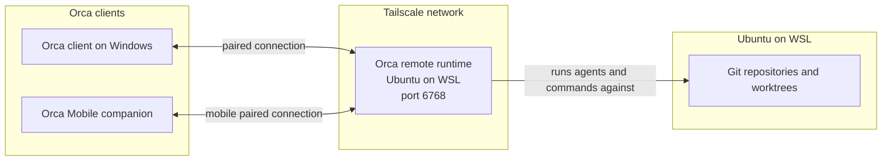

# Orca on WSL

## How it connects

The Orca clients connect to the remote runtime over Tailscale. The runtime runs agents and works with repositories on the WSL filesystem; clients do not connect to those repositories directly.

The Windows client is already paired to this runtime. Mobile pairing is a separate setup: for a headless server, Orca documents `--mobile-pairing`; the phone must be able to reach the server, for example on the same Tailscale network. See [Orca's mobile pairing guide](https://www.onorca.dev/docs/mobile#pairing) and [remote server guide](https://www.onorca.dev/docs/remote-servers#mobile-from-a-headless-server). This repository documents the WSL setup; it does not contain mobile pairing credentials.

## Setup notes

Setup and troubleshooting notes for running the Orca remote runtime in Ubuntu on WSL and connecting to it from the Orca client on Windows.

See [ORCA-WSL-SETUP.md](ORCA-WSL-SETUP.md) for the service configuration, startup and health checks, Tailscale notes, and recovery steps.

The pairing URL contains a device token. It is intentionally excluded from this public repository. The guide also avoids publishing machine IP addresses.
